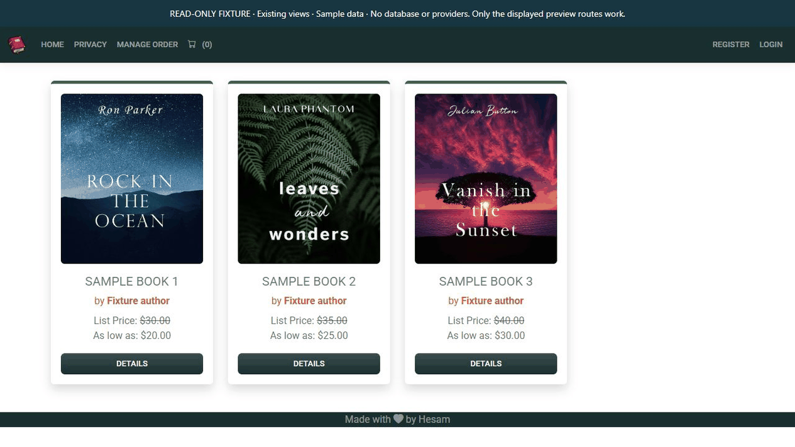

# Bulky MVC

An educational ASP.NET Core MVC bookstore application covering product administration, shopping carts and order workflows.

## Captured preview

<picture><source media="(prefers-reduced-motion: reduce)" srcset="docs/screenshots/portfolio-poster.png" /><source type="image/webp" srcset="docs/screenshots/portfolio.webp" /></picture>

Existing bookstore Razor views: catalog and product details, rendered with synthetic models. No cart, order or payment transaction.

[Reproduce this capture and view the static image](docs/PORTFOLIO-PREVIEW.md)

## Implementation highlights

- Product/category/company management and customer storefront pages.
- Cart, order and Stripe integration code.
- ASP.NET Core Identity accounts with Customer, Company, Employee and Admin roles.
- Public registration always creates Customer accounts. Only an already authenticated administrator can select supported roles while creating another account.

## Repository map

| Path | Purpose |
|---|---|
| [Bulky.Models](Bulky.Models) | Entities and view models |
| [Bulky.DataAccess](Bulky.DataAccess) | EF Core, repositories and database initialization |
| [Bulky.Utility](Bulky.Utility) | Shared constants and supporting integrations |
| [BulkyWeb](BulkyWeb) | Main MVC application with Admin and Customer areas |
| [BulkyWebRazor_Temp](BulkyWebRazor_Temp) | Separate Razor Pages learning sample |
| [tests/Authorization.Tests](tests/Authorization.Tests) | Registration, ownership, order/payment rules and HTTP antiforgery regressions |

## Requirements and configuration

Use an SDK capable of targeting .NET 10 and an isolated SQL Server development database. Package restore requires access to the configured NuGet feeds. The projects target .NET 10 LTS. Install the latest supported .NET 10 SDK and runtime patch.

Read [SECURITY-SETUP.md](SECURITY-SETUP.md) before configuring credentials. Tracked secret values are intentionally empty. Use environment variables for your own development resources; do not restore old values from Git history.

The main host reads `ConnectionStrings:DefaultConnection`; configure it with `ConnectionStrings__DefaultConnection`. Payment, email and external-login features require their own development provider settings. They are not provisioned by cloning the repository.

**Review startup before running:** the main host invokes [DbInitializer.cs](Bulky.DataAccess/DbInitializer/DbInitializer.cs), which can migrate and seed the configured database. Use an approved, disposable development target. The Razor Pages sample has separate host settings and is not required to run the main bookstore.

## Build and run

```powershell
git clone https://github.com/s-hesam-s/Bulky_MVC.git
cd Bulky_MVC
```

```powershell
dotnet restore Bulky.sln
dotnet build Bulky.sln --no-restore
```

After configuration and database review:

```powershell
dotnet run --project BulkyWeb/BulkyBookWeb.csproj --launch-profile https
```

Open `https://localhost:7116`, the main host's checked-in HTTPS address. Start with the storefront and Customer registration. Administrator access must already be provisioned through a trusted process.

For the independent Razor Pages sample, use `BulkyWebRazor_Temp/BulkyBookWebRazor_Temp.csproj` and its own launch settings after reviewing its database configuration.

## Verification

```powershell
pwsh -File scripts/Test-PublicConfiguration.ps1
dotnet test tests/Authorization.Tests/Authorization.Tests.csproj
```

The authorization tests use mocked dependencies, with in-memory HTTP checks where applicable. They do not start the application or apply database migrations. Build and test results do not establish that a full deployment or external integration is configured.

## Project scope and reuse

This is an educational repository. The implementation notes describe the code in this repository; they do not claim a deployed commercial service or measured production results. Third-party libraries and assets retain their own terms. No project-wide license is currently declared.

## Continuous integration

GitHub Actions restores and builds `Bulky.sln` in Release mode on Windows using the .NET 10 target. It also runs `scripts/Test-PublicConfiguration.ps1` without printing configured values. The existing authorization regressions run with mocked dependencies and in-memory HTTP hosts where applicable. The application hosts, database migrations/seeds, cloud integrations and payments are not started by CI.

The [CI workflow](.github/workflows/ci.yml) runs for pull requests and pushes to `master`, and can be started manually. It uses read-only repository permissions and does not deploy the project.

## Runtime maintenance

See [runtime, dependency audit and migration notes](docs/RUNTIME.md) for the .NET 10 target and verification boundaries.

[Local verification snapshot](docs/VERIFICATION.md) records the build, isolated-test and dependency-audit boundaries.

## Maintenance checks

The existing CI also runs weekly on Monday and checks tracked Markdown file destinations with `scripts/check_doc_links.py`. Its negative tests cover moved documents, missing picture variants, paths outside the repository and untracked local drafts. External URLs and heading fragments are intentionally outside this offline file check. Scheduled runs do not deploy or start original application hosts.
