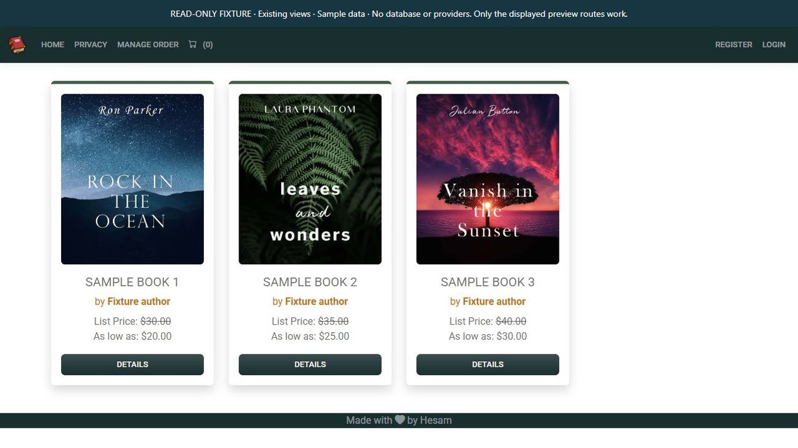

# Bulky MVC · captured evidence

Existing bookstore Razor views: catalog and product details, rendered with synthetic models. No cart, order or payment transaction.



[Animated WebP](screenshots/portfolio.webp) · [GIF fallback](screenshots/portfolio.gif)

## Reproduce locally

Requires .NET 10 SDK and NuGet access. From the repository root:

```powershell
dotnet restore tools/Preview/Preview.csproj
dotnet build tools/Preview/Preview.csproj --configuration Release --no-restore
dotnet run --project tools/Preview/Preview.csproj --configuration Release --no-build --no-launch-profile
```

Open `http://127.0.0.1:8840/`; stop with Ctrl+C. The helper binds only to loopback and clears its configuration sources. It does not invoke the original application entry point, register a DbContext, run migrations or call providers. `/preview-info` describes the isolation. All non-GET methods return 405. Unsupported application routes return 404.

The helper registers only its preview controller and renders the existing compiled Razor views. Layout links outside the preview route set are intentionally unavailable; save/cart/order controls do not complete operations. The Bulky preview strips the original TinyMCE CDN script from its rendered response. No original source view is replaced.

## Evidence boundary

Captured on 2026-10-28 from the checked-in implementation and clearly marked sample inputs. Animated media concatenates actual captured UI states with readable dwell times; it does not simulate a completed transaction. No production, cloud, database, payment, identity or email operation is implied. Static PNG is available above for reduced motion.
